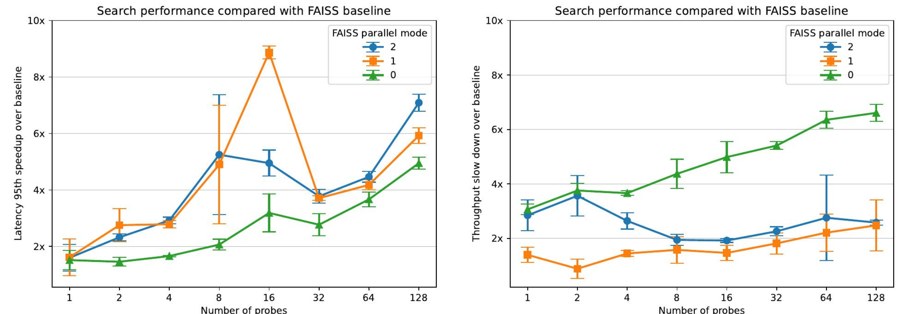
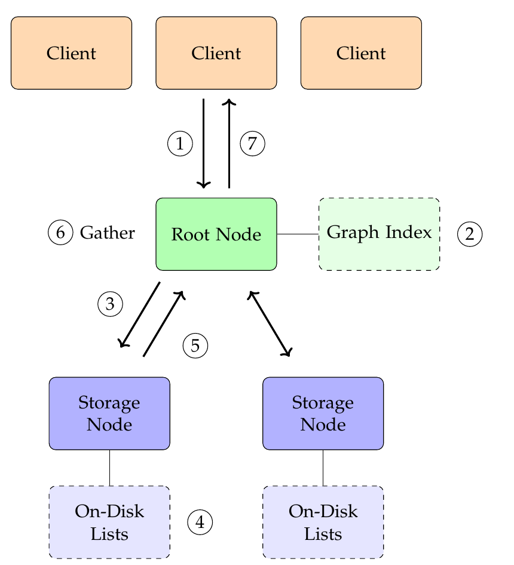

# Large-Scale, Out-of-Memory Approximate Nearest Neighbor Search Using An In-Memory Index

Bachelor's thesis at the Systems Group, Department of Computer Science, ETH Zurich,
September 2022 – March 2023. Timon Fercho, supervised by Prof. Gustavo Alonso and Wenqi Jiang.

**[Read the thesis (PDF)](thesis.pdf)**

The storage node of a distributed vector retrieval engine, in C++. It manages the on-disk partitions
and enables efficient nearest neighbor search, making use of the high-performance optimizations SIMD
and OpenMP.

## Results

- **3–6x lower latency than FAISS**, a state-of-the-art system for similarity search. FAISS in turn
  outperforms the system in throughput by 5x.
- **Search throughput speedups of 14x and 3–9x in latency** over the same system without SIMD and
  OpenMP.



*Left: 95th-percentile latency speedup over FAISS. Right: throughput slowdown. FAISS parallel mode 0 is
its default, parallel only over queries. Measured on BIGANN subsets; from the thesis presentation.*

## Design

A root node and several storage nodes, queried through a distributed key-value store-like interface.
During index construction, the vectors are clustered into lists. Each storage node stores a subset of
the lists on its local disk, and the centroids are inserted into a graph-based index at the root node.

<p align="center"></p>

*Query processing. In step 6, the root node gathers and reranks the results from the storage nodes.*

The root node searches the graph-based index for the closest centroids and queries only the storage
nodes holding those partitions. They search their lists in parallel, and the root node merges and
reranks the results. This more fine-grained index results in better load balancing than previous
approaches.

**This repository implements the scope of the thesis: the single-server case of the storage node and a
scan-based root index.** It was continued in a later Master's thesis at ETH Zurich,
[*A Distributed System for Large Scale Vector Search*](https://www.research-collection.ethz.ch/entities/publication/b66c2894-7245-49f4-8fe6-86c44cf2fe5f) (2024).

## Layout

| Path | Holds |
|---|---|
| `src/`, `include/` | The storage node (`storage-node/`: on-disk lists, index, search) and the root index (`root-node/`) |
| `tests/` | Catch2 unit tests and microbenchmarks, tagged by component and dataset |
| `cluster/` | Scripts that cluster BIGANN into partitions and lay them out on disk |
| `evaluation/` | The benchmark driver (`batch-bench.py`, `benchmarks.json`), raw results, notebooks and plots |
| `evaluation/baselines/` | The FAISS on-disk IVF baseline and the I/O throughput measurements |
| `prototype/` | The Python system prototype, with `hnswlib` (v0.7.0, a submodule) for the graph-based root index |

## Building and running

The thesis measurements ran on Linux on an x86 server (Intel Xeon E5-2640 v3, 16 cores, 256 GB RAM),
built with `g++` and C++17, with AVX and OpenMP.

```bash
make test                      # builds out/testmain with SIMD (AVX) and OpenMP on
make test USE_SIMD=0 USE_OMP=0 # the baseline configuration
./out/testmain --list-tags     # the tests and benchmarks, by tag
./out/testmain "[StorageLists]"
```

Further flags are in the `Makefile`. The BIGANN tests expect the clustered dataset under `cluster/out`
(paths in `include/tests/TestConfig.hpp`); `evaluation/batch-bench.py` runs the benchmark configurations.
